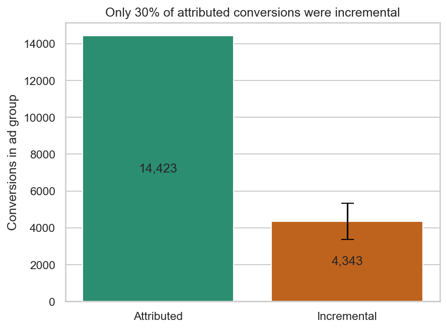
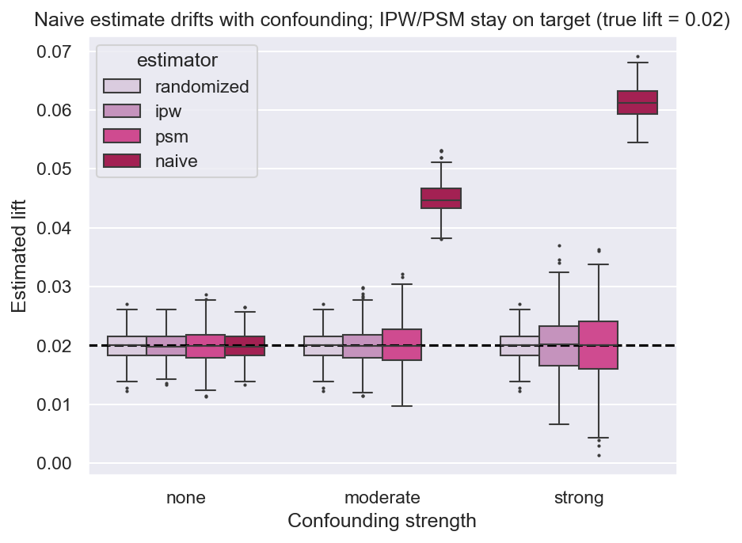
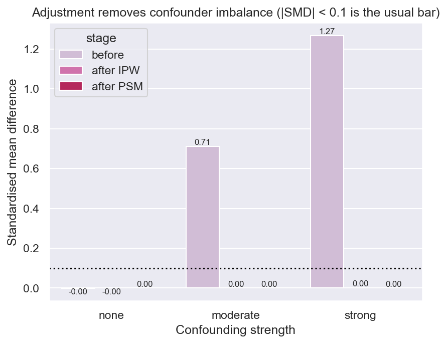
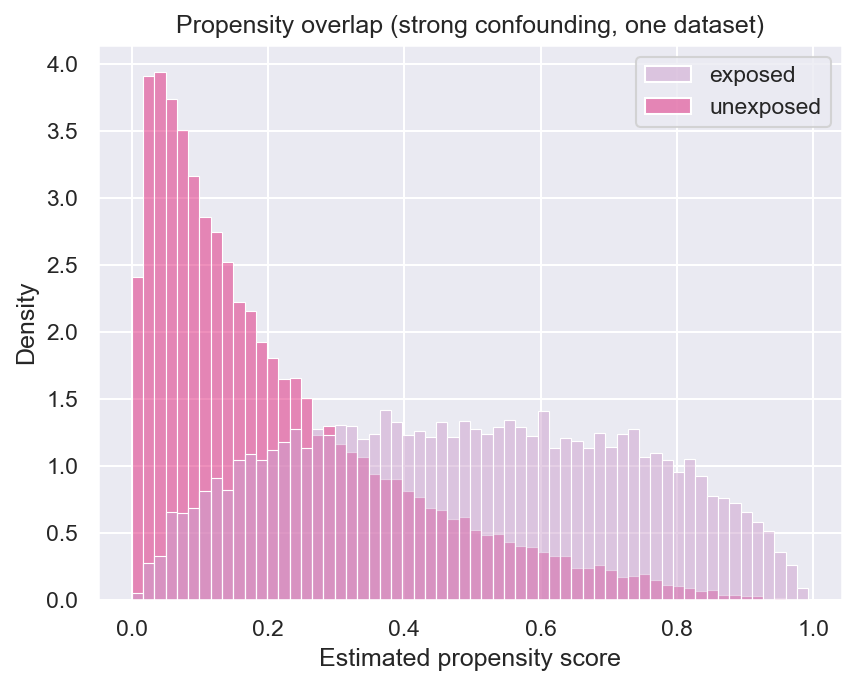
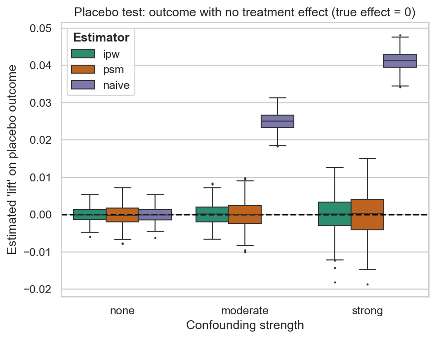
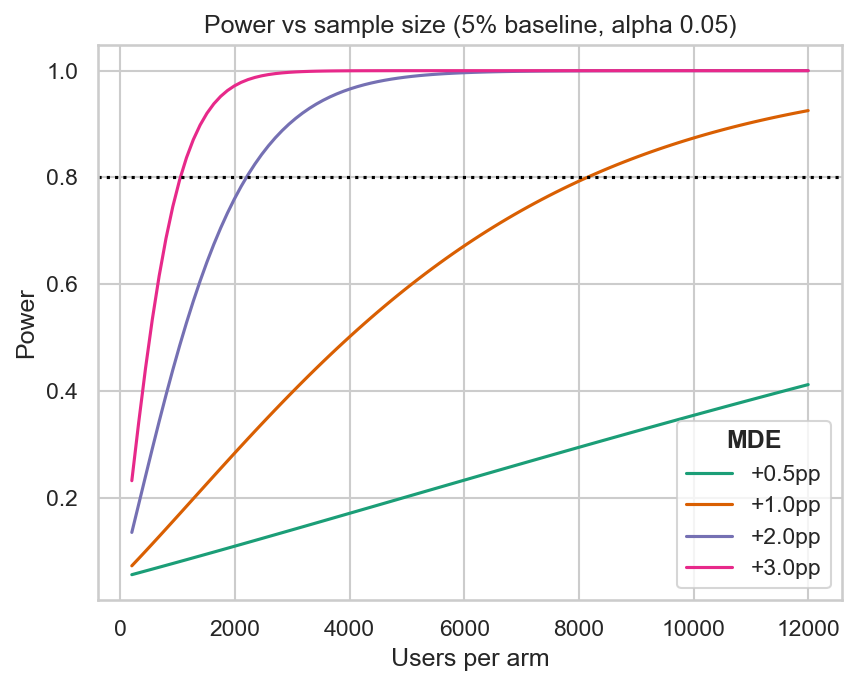

# Measuring Incremental Marketing Lift: Attributed vs. Causal Conversions

Ad platforms report every conversion that follows an ad as "caused" by it, which overstates what the campaign actually earned and leads to overspending. Finding the true incremental lift, and knowing whether the method used to estimate it can be trusted, is what separates a defensible budget decision from a flattering dashboard.

**Problem:** Estimate how many of a campaign's conversions were truly incremental (would not have happened without the ad), using a real holdout experiment, and then test whether common causal methods can recover a known effect when exposure is *not* random.

**Approach decision:** Split the work in two. Part 1 analyzes a real ad-vs-PSA holdout (588,101 users), where the randomized control makes a causal reading possible but the truth is unknown. Part 2 uses simulated data with a known true lift (+2pp) and built-in confounding, because only a known answer can show whether a method is right, not just that it ran. Compared four estimators against the truth over 500 replications at three confounding levels, with a power analysis up front, rather than trusting a single run.

**What broke:** The naive comparison of exposed vs. unexposed users. In the simulation it overstated the +2pp lift by 2.5pp under moderate confounding and 4.1pp under strong, and its 95% confidence interval contained the true value 0% of the time: precise, and wrong. In the real data, attributed conversions overstated the incremental effect by more than 3x.

**Metric:** On real data, a +0.77pp lift (95% CI 0.60 to 0.94pp) means only **~30% of attributed conversions were incremental** (~4,343 of 14,423). In simulation, IPW and propensity matching recovered the true effect with under 0.02pp bias at every confounding level.



## Analysis Flow

```
Part 1 (real data):  marketing_AB.csv -> clean + check -> balance check -> z-test + bootstrap CI -> attributed vs incremental
Part 2 (synthetic):  power analysis -> simulate known effect + confounder -> naive / randomized / IPW / PSM
                     -> 500 replications x 3 confounding levels -> bias, RMSE, CI coverage -> balance, overlap, placebo diagnostics
```

## Tech Stack

- Python: analysis, simulation, orchestration
- pandas / NumPy: data handling and vectorized simulation
- SciPy / statsmodels: hypothesis tests, power analysis
- Custom Newton-Raphson logistic regression for propensity scores (matches statsmodels' Logit exactly)
- matplotlib / seaborn: figures
- pytest: tests on the statistics and the simulation
- Jupyter: narrative notebooks

## Dataset

- **Part 1 (real):** Kaggle "Marketing A/B Testing": 588,101 users, 564,577 in the ad group and 23,524 in the PSA (control) group. Columns: test group, converted, total ads seen, day and hour of most ads
- **Part 2 (synthetic):** generated in code, never real users. Baseline conversion 5%, true lift +2pp, n = 50,000, ~30% exposed, one confounder that raises both exposure and conversion
- The control group saw a public service announcement, not nothing, so the real-data estimate is the ad's effect **relative to a PSA**
- Raw data is not included in the repo (see Setup)

## Pipeline

1. Load and clean the real data (drop index column, standardize names); confirm no duplicate users or missing values
2. Check group balance and covariate balance across ad vs. PSA
3. Estimate the lift with a two-proportion z-test, cross-checked against statsmodels, plus a bootstrap CI
4. Convert the lift into attributed vs. incremental conversions with uncertainty
5. Run a power analysis to size the experiment
6. Simulate data with a known +2pp effect under none, moderate and strong confounding
7. Estimate the effect four ways (naive, randomized holdout, IPW, PSM) over 500 replications per level
8. Check balance (standardized mean differences), propensity overlap, and a placebo outcome with zero true effect

## Results

### Part 1: Real data

| | Ad | PSA (control) |
|---|---|---|
| Users | 564,577 | 23,524 |
| Conversions | 14,423 | 420 |
| Conversion rate | 2.555% | 1.785% |

| Metric | Value |
|---|---|
| Lift (absolute) | +0.77pp (95% CI 0.60 to 0.94pp, bootstrap) |
| Lift (relative) | ~43% |
| z-test | z = 7.37, p ≈ 1.7e-13 |
| Attributed conversions | 14,423 |
| Incremental conversions | ~4,343 (95% CI ~3,370 to 5,320) |
| Incremental share | 30% |

Covariate balance on day and hour of most ads is imperfect (Cramér's V ≈ 0.02); adjusting for them moves the lift from 0.7692pp to 0.7679pp, so the result does not depend on it. Those variables may be measured after assignment, so this is a sanity check, not proof of randomization.

### Part 2: Simulation (synthetic, true lift = +2pp, 500 replications per level)

| Confounding | Estimator | Mean estimate | Bias | RMSE | 95% CI coverage |
|---|---|---|---|---|---|
| None | Naive | 1.99pp | -0.01pp | 0.23pp | 95.4% |
| Moderate | Naive | 4.49pp | +2.49pp | 2.51pp | 0% |
| Moderate | Randomized holdout | 2.00pp | 0.00pp | 0.24pp | 94.8% |
| Moderate | IPW | 1.99pp | -0.01pp | 0.31pp | 90.0%* |
| Moderate | PSM | 2.01pp | +0.01pp | 0.39pp | 99.0%* |
| Strong | Naive | 6.13pp | +4.13pp | 4.14pp | 0% |
| Strong | IPW | 2.00pp | 0.00pp | 0.49pp | 95.0%* |
| Strong | PSM | 2.01pp | +0.01pp | 0.59pp | 96.0%* |

\*Coverage for IPW and PSM uses bootstrap CIs on 100 replications per level (all 500 was too slow), so it is imprecise (about ±4 to 5pp). Bias and RMSE use all 500. Full table is written to `data/processed/sim_summary.csv`.



IPW and PSM remove the bias but are noisier: RMSE roughly doubles from no confounding to strong, the price of adjustment.

### Diagnostics



The confounder's standardized mean difference falls from about 0.71 (moderate) and 1.27 (strong) to about 0 after IPW or matching.



Exposed and unexposed users share common support, so reweighting and matching are possible.



On an outcome with no treatment effect, IPW and PSM estimate about 0 while the naive estimator finds a large false effect.

### Power analysis



Detecting 5% to 7% at 80% power and alpha 0.05 takes 2,198 users per arm; halving the effect roughly quadruples that. With the real 24:1 design (23,524 control users), the smallest detectable lift is about 0.41pp at a 5% baseline and about 0.26pp at the observed 1.79% baseline.

### Assumptions and limits

- Real data: random assignment, no interference between users, no differential attrition. None can be verified from the data alone.
- Simulation: one observed confounder with a correctly specified model (the best case), a constant treatment effect, and no interference. Unmeasured confounding cannot be fixed by IPW or PSM.
- No ROI is claimed: the dataset has no cost or value-per-conversion.

## Setup

### Prerequisites

- Python 3.11+
- The Kaggle "Marketing A/B Testing" CSV saved as `data/raw/marketing_AB.csv` (not included in the repo)

### Installation

```
python3.11 -m venv venv
source venv/bin/activate
pip install -r requirements.txt
```

### Running the Project

1. Clone the repo and add the CSV to `data/raw/`
2. Run `make all` to run the tests, the simulation (about 15 to 25 minutes), then both notebooks
3. Or run pieces separately: `pytest`, `python -m src.run_sim`, then open the notebooks in `notebooks/`

Seeds are fixed, so results reproduce. Logic lives in `src/`; the notebooks hold the narrative and figures.

## Acknowledgements

Real-data analysis uses the Kaggle "Marketing A/B Testing" dataset. All Part 2 data is synthetic.

## Reflection

A conversion count from an ad platform and a causal effect are different quantities, and the gap between them is where budget decisions go wrong. Simulating a world where the true answer is known was the only way to show which methods deserve trust.
